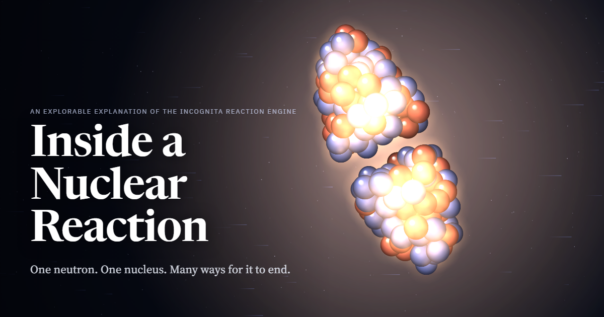

# Incognita

**Open, calibrated predictions of neutron reaction cross sections across the chart of nuclides, with a public blind
benchmark and a registry of predictions made before the data.**

[](LICENSE)
[](LICENSE-DATA)
[](#status-and-limitations)
[](docs/GUIDE.md#engine-versions)
[](pyproject.toml)

<a href="https://nucleus-incognita-woad.vercel.app/?lang=en"></a>

**New here?** Start with [**Inside a Nuclear Reaction**](https://nucleus-incognita-woad.vercel.app/?lang=en), an
interactive walk through what the engine computes; [**Every nuclide**](https://nucleus-incognita-woad.vercel.app/data?lang=en),
an explorer of the library's predicted curves for 6,168 nuclides beside every curated measurement; and the
[**Scoreboard**](https://nucleus-incognita-woad.vercel.app/scoreboard?lang=en), which compares the engine with other
codes and the data product with evaluated libraries, losses first.

## What is this

Most nuclei have never had a neutron cross section measured, yet reactors, nucleosynthesis networks, fusion shielding
and isotope production all need values for them. Incognita gives each nuclide **a value**, **an uncertainty interval**
whose coverage has been tested on nuclei held out of the fit, and **a regime label** (measured, anchored, interpolated
or extrapolated). The code, the predictions, the exam they were graded on and timestamped predictions for nuclei not
yet measured are all public, so every claim can be checked.

## Highlights

| | |
|---|---|
| **Coverage** | 6,168 nuclides (Z = 8–110), 1 keV – 20 MeV: capture, MACS, stellar rates, (n,p), (n,2n), (n,α) |
| **Held-out capture** | with measured D0, beats the default TALYS recipe on the sealed vault: 0.1519 vs 0.1712 dex |
| **Tested intervals** | 95 % interval covers 95.3 % of 674 sealed capture bins published after 2012 |
| **Engine** | a Python/C port of TALYS-2 physics; matches stock TALYS to four decimals on total, elastic, (n,p), (n,α) scores; 11.7x faster per target (no cache) |

Ties and losses are reported too: see the [full benchmark](docs/GUIDE.md#benchmark).

## Quick start

Needs Linux or macOS, Python 3.12 and [uv](https://docs.astral.sh/uv/).

```bash
git clone https://github.com/seth-michael-weaver/incognita.git incognita && cd incognita
uv sync --extra dev
uv run python -m incognita.library show Au-197    # capture curve with 68 / 95 % bands, MACS at 30 keV
bash scripts/reproduce.sh                         # regenerate the benchmark tables and compare with the shipped ones
```

Running the engine itself needs the TALYS structure database: see [Running the engine](docs/GUIDE.md#running-the-engine).

## What is in the repo

| path | content |
|---|---|
| [`library/v0.1/`](library/v0.1/) | the predictions (CC-BY-4.0) |
| [`incognita/`](incognita/) | library reader, benchmark scorer and tracks, calibration and curation tools |
| [`physics/`](physics/) | the Hauser–Feshbach engine |
| [`scripts/`](scripts/) | `reproduce.sh`, scorers, engine driver, native-kernel builds |
| [`docs/release/`](docs/release/), [`docs/registry/`](docs/registry/) | frozen exam inputs and expected tables; pre-registered predictions |
| [`emu/`](emu/) | fast emulators of the engine |
| [`docs/walkthrough/`](docs/walkthrough/) | the explainer website |

The full layout is in the [guide](docs/GUIDE.md#repository-layout).

## Status and limitations

This is a **v0.1 preview**: research output, not an evaluation. Held-out tests are retrospective; the pre-registered
predictions have not yet been scored against new measurements. There is no claim of better accuracy than evaluated
libraries for measured nuclei; where good data exist, use the data or an evaluation. All numbers come from the v0.1
engine. Details: [Status and limitations](docs/GUIDE.md#status-and-limitations).

## Learn more

- [Using the library](docs/GUIDE.md#using-the-library): format, regime tiers
- [Running the engine](docs/GUIDE.md#running-the-engine) and [engine versions](docs/GUIDE.md#engine-versions)
- [Method](docs/GUIDE.md#method): physics, global rules, independence from evaluated libraries, curation
- [Benchmark](docs/GUIDE.md#benchmark), [performance](docs/GUIDE.md#performance) and
  [reproducing the numbers](docs/GUIDE.md#reproducing-the-numbers)
- [Prospective registry](docs/GUIDE.md#prospective-registry)
- [Acknowledgements](docs/GUIDE.md#acknowledgements)

## Emulator

Millisecond emulators of the engine, with Jacobians and sampling: [`emu/README.md`](emu/README.md).

## Citing

Use [`CITATION.cff`](CITATION.cff), and also cite EXFOR (N. Otuka et al., Nucl. Data Sheets 120 (2014) 272) and
TALYS (A. Koning, S. Hilaire, S. Goriely, Eur. Phys. J. A 59 (2023) 131) when you use the engine or the EXFOR-derived
tables.

## Licence

Code: Apache-2.0 ([`LICENSE`](LICENSE), [`NOTICE`](NOTICE)); predictions and data: CC-BY-4.0
([`LICENSE-DATA`](LICENSE-DATA), including third-party terms); ported TALYS routines keep their MIT notice
([`physics/hf/NOTICE-TALYS.md`](physics/hf/NOTICE-TALYS.md)).

## Contributing

See [`CONTRIBUTING.md`](CONTRIBUTING.md) and the [Code of Conduct](CODE_OF_CONDUCT.md). If a number here is wrong,
please open an issue with the measurement.
